<picture>
  <source media="(prefers-color-scheme: dark)" srcset="card-dark.svg">
  <source media="(prefers-color-scheme: light)" srcset="card-light.svg">
  
</picture>

Most of my work is in private repositories. Public trail:

```
$ gh search prs --author meshoklv --owner willfaust
```

- [`Madeira#148`](https://github.com/willfaust/Madeira/pull/148) crash guard counts only back-to-back identical fault redeliveries
- [`Madeira#149`](https://github.com/willfaust/Madeira/pull/149) polling process's main window stays foreground for XInput
- [`Madeira#150`](https://github.com/willfaust/Madeira/pull/150) touch taps that miss the controls no longer act as mouse input
- [`Madeira#385`](https://github.com/willfaust/Madeira/pull/385) low name for images whose base gets narrowed to 32 bits (Steam emulators); VirtualQuery reports only allocatable memory as free *(open)*
- [`wine#18`](https://github.com/willfaust/wine/pull/18) [`wine#19`](https://github.com/willfaust/wine/pull/19) ARM64EC syscall return path; builtin XInput even when a game ships its own
- [`Madeira#56`](https://github.com/willfaust/Madeira/issues/56) Dark Souls Remastered (PC, Arxan-protected) playable on iPhone Air, no game file changes

[Madeira](https://github.com/willfaust/Madeira) runs x86-64 Windows PC games on non-jailbroken iOS (FEX-Emu + Wine + DXMT).

`~ $` [t.me/meshoklv](https://t.me/meshoklv) · [instagram.com/meshoklv](https://instagram.com/meshoklv) · [github.com/meshoklv](https://github.com/meshoklv)
